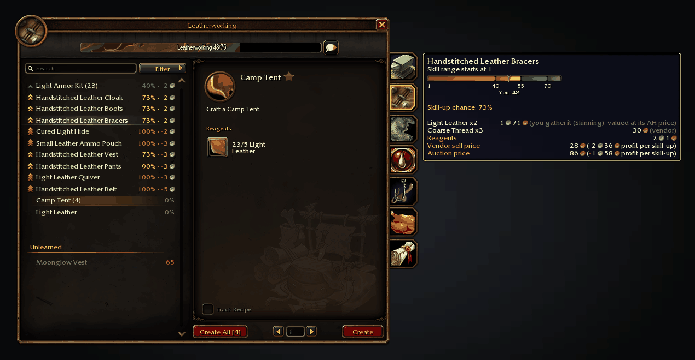
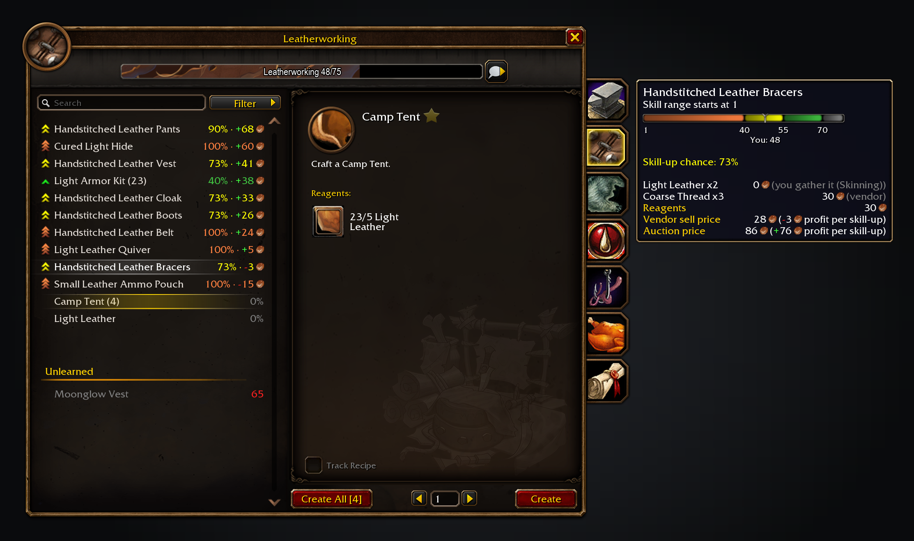
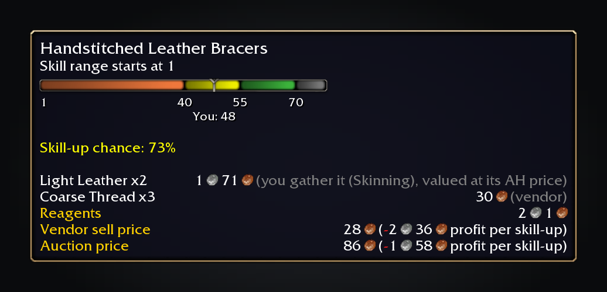
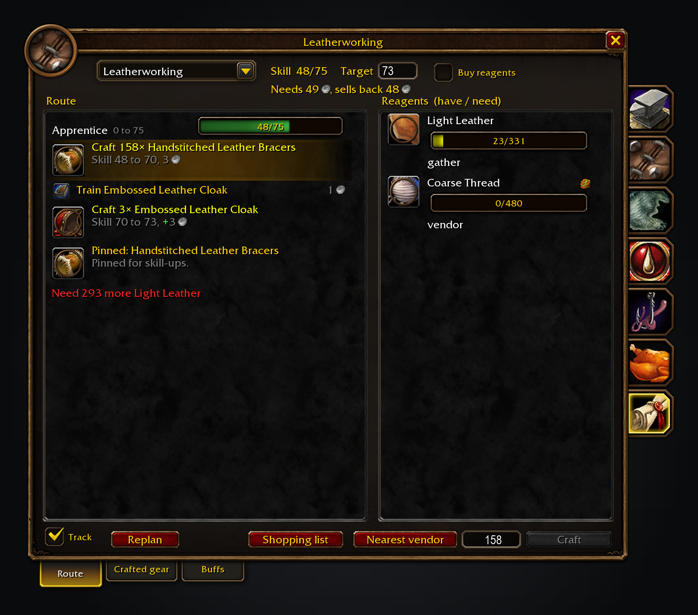
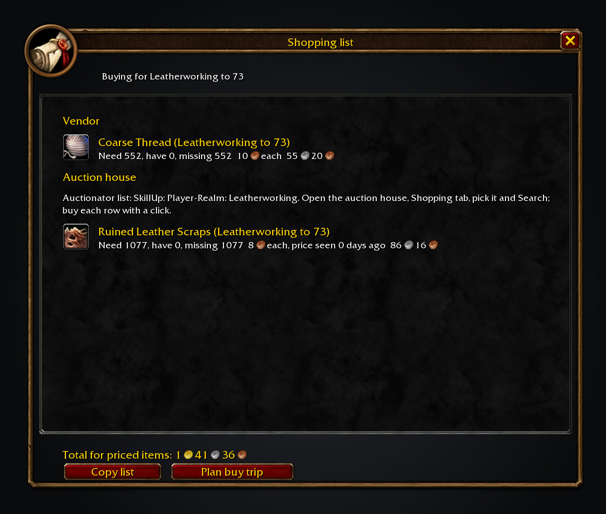
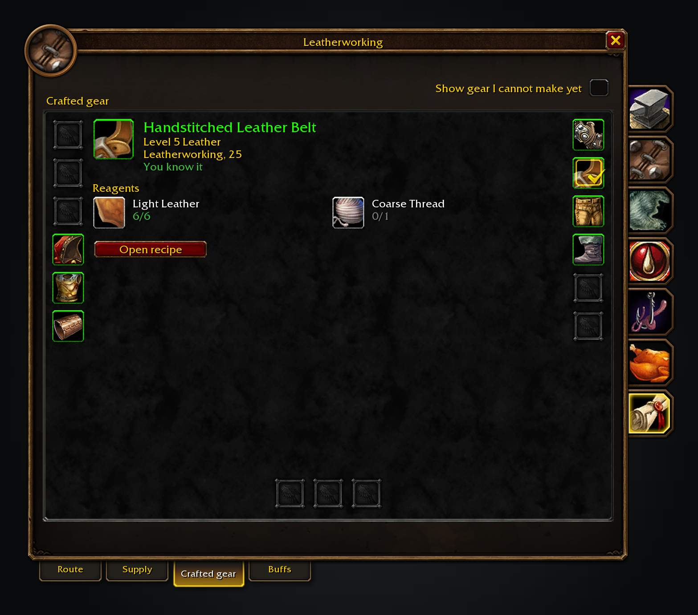
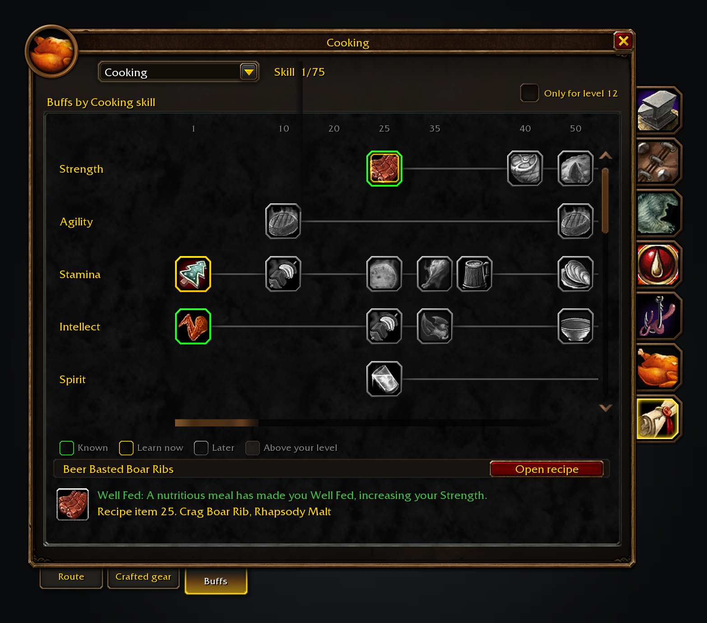
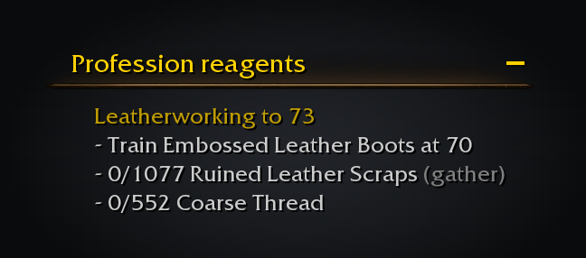
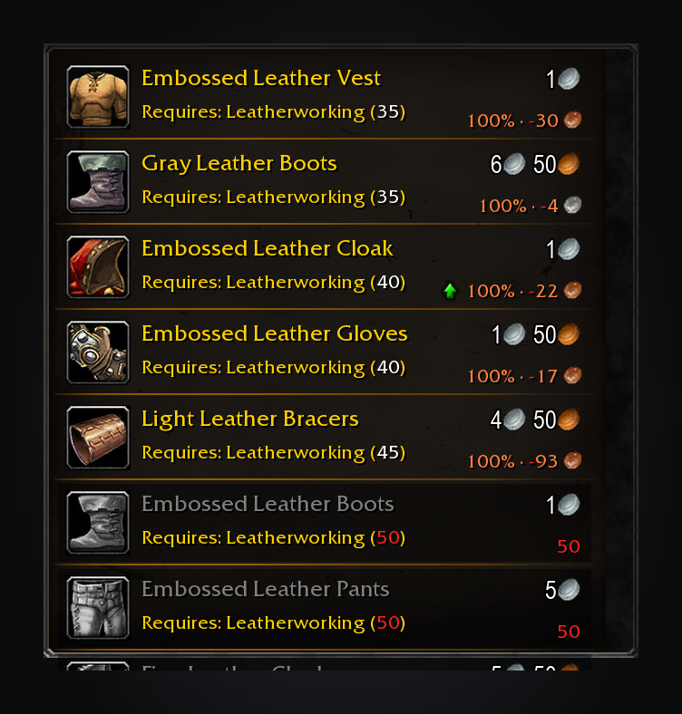
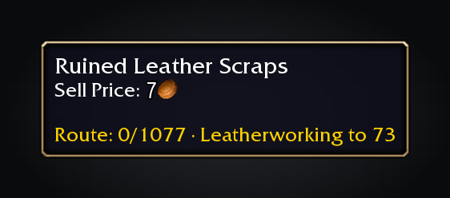

<h1 align="center">SkillUp Forever</h1>

Classic profession-levelling numbers inside WoW: Forever's Professions window. 

   

SkillUp Forever shows skill-up chances, recipe costs and colour thresholds in the Professions window, with levelling routes, shopping lists, crafted gear and buffs in its side panel.

## Known limitations

- Recipe colours come from the game, but a recipe you have not seen yet uses bundled thresholds that can be slightly off.
- Trainer fees, requirements and drop chances come from Classic databases, as the game lists none until you visit.
- Gathering nodes and corpses have no colour in the game, so theirs is an estimate.
- Prices need an auction scan or a price addon; until then, steps show a price unknown.
- Working Overtime's bonus (4% per rank, 20% at 5/5) is not confirmed as added points or a multiplier, so the estimate is off by default; turn on Include Working Overtime estimate to see the additive reading.
- With a controller, closing the Professions window while a SkillUp sort or the unlearned list is on can report a blocked action. It does no harm; reopen the window to carry on.
- With two professions tracked that share reagents, the shopping list can count the same bag items for both.

From 48 to 60 the rows re-sort by cost per skill-up, and Handstitched Leather Bracers turns green at 55.

Each row shows its chance and cost; the tooltip prices each reagent. This character skins, so Light Leather is valued at what selling it would bring.

The tooltip draws the thresholds on the game's bar, then each reagent's price and the cost per skill-up.

## Features

- **Recipe rows and tooltips** show skill-up chance, cost, colour thresholds and how many your bags can make.
- **Sorting** orders recipes by difficulty range start, chance, cheapest skill-ups, highest craft profit or newest learned first; unlearned ones sort separately.
- **Unlearned recipes** can sit under the learned ones, greyed and marked with their trainer or recipe item, and the search box narrows them. Click one to preview its read-only details in the crafting pane.
- **Buffs only** filters the list to the buffs you can use at your level.
- **Levelling routes** list the crafts, trainer visits, skill books and rank quests to your target skill, in order, each with its amount and cost. [Route details](docs/route.md#levelling-route).
- **Shopping lists** count reagents against bags and bank and keep an Auctionator list current. At the auction house, click *Search* in the Professions window to find the reagents still needed for the crafts you choose. [Shopping details](docs/route.md#shopping-list).
- **Supply page** sits beside the route: with a profession and a merchant open, note what you assume about each offer's price, stock, limit and trips, then read the route's chance. [Supply details](docs/supply-policy.md).
- **Trainer annotations** show chance and cost, with a green arrow on the best recipe for your route.
- **Reagent tooltips**, on in settings, show what tracked routes need; Shift lists every recipe that uses the item, naming its profession. Herb and ore nodes show the skill they need, coloured at yours.
- **Crafted gear** shows the newest item you could craft for each slot, with its recipe and reagents. [Gear details](docs/gear.md).
- **Buffs** show what each profession can make for your level on a skill timeline. [Buffs details](docs/buffs.md).

The route from 48 to 73, in order, with each craft's amount, range and cost.

The shopping list groups what is missing by source, with bag and alt holdings beside prices.

The gear tab, turned on in settings: each slot's newest craft for this character.

The buffs tab: each effect by the skill it is learned at, with the selected buff's source.

Tracked, the route sits beside your quests: the next trainer visit and what is still missing.

At the trainer, each recipe shows its chance and cost; a green arrow marks the best next one.

Hover a reagent to see how much your tracked routes need.

## Install

Install it from [CurseForge](https://www.curseforge.com/wow/addons/skillup-forever), or take the zip from [Releases](https://github.com/cjber/skillup-forever/releases) and extract it into the client's `Interface/AddOns/` folder (`_forever_` on the live client).

## Usage

Open a profession and the numbers are already there.

| Command | What it does |
|---|---|
| `/skillup` | Open the settings (also in Settings → AddOns or the addon compartment) |
| `/skillup skipped` | List the recipes you said *Not this recipe* to, and `/skillup unskip <ID>` (or `all`) brings them back |
| `/skillup audit` | Compare the bundled thresholds with the colours the game shows |
| `/skillup report` | Show a report to copy into a bug report |
| `/skillup issue` | Open a ready-made GitHub issue link to report a bug or request a feature |
| `/skillup shopping`, `/skillup shop` | Open the shopping list, copy it, or plan a buy trip with Shortest Path Forever |
| `/skillup trainers` | List the trainer skill requirements SkillUp guessed, and which ones a trainer confirmed |

Settings cover rows and tooltips, prices, sort order, the tabs and trainer annotations. **Include Working Overtime estimate** starts off, so chances use the base formula. Crafted gear and reagent tooltips start off, each one setting away; Supply has its own checkbox.

## Prices

Each reagent uses the cheapest known vendor or auction price, and visiting a vendor records its prices and reputation discounts. *Buy reagents* is on by default, so materials your professions gather are bought; choose gathering to supply them yourself. *Value gathered materials at what they'd sell for* is on for new installs and costs them at their sale value; turn it off to count them as free. *Price self-supplied reagents at auction values* prices what you gather, loot or own at market value, and leaves it unpriced when there is none.

Auction prices come from Auctionator's latest scan, TradeSkillMaster's AuctionDB with its desktop app, AHDB, or Naowh Forever's scans and nightly auction data. Naowh's snapshot can price materials before your first auction house visit. *Auction prices from* picks which source wins, and the others fill the gaps. SkillUp starts an Auctionator search when you click *Search* in the Professions window. Prices stay unknown until a price source records them.

A craft's vendor sell value comes off its cost, or its auction value after the 5% cut if you choose. *Region sale average if higher* uses regional sales with the vendor price as a floor, and recipe tooltips add TSM's regional sales per day where it has them. Profit shows a green `+`, and cost per skill-up divides net cost by chance.

## How the numbers work

Each recipe has four thresholds: orange (start of its skill range), yellow, green and grey. Chance follows the Classic formula:

| Colour | Chance |
|---|---|
| Orange | 100% |
| Yellow, green | `(grey − skill) / (grey − yellow)` |
| Grey, or at your skill cap | 0% |

The colour comes from the game, the grey band uses its live value where the client reports one, and missing or contradictory ranges show `?`.

**Found a wrong number?** Run `/skillup report` in that profession and paste it into a [Wrong number issue](https://github.com/cjber/skillup-forever/issues/new?template=wrong_number.yml).

## Works alongside

All optional: Auctionator, TradeSkillMaster, AHDB and Naowh Forever supply auction prices; Auctionator also takes the shopping list, TomTom draws waypoint arrows, and Syndicator shows your alts' reagents. [Questie](https://www.curseforge.com/wow/addons/questie) names the vendors, quests and trainers the route points to, and [AtlasLoot Classic Forever](https://www.curseforge.com/wow/addons/atlasloot-forever) names the scroll that teaches each recipe.

<!-- forever-family:start -->

## The Forever addons

Each one works on its own, and they work together when you install more than one.

| Addon | What it does | Issues |
|---|---|---|
| [Shortest Path Forever](https://www.curseforge.com/wow/addons/shortest-path-forever) | Plans journeys on foot, by air, by sea and through portals, with directions in the tracker. | [Issues](https://github.com/cjber/shortest-path-forever/issues) |
| [Adventure Guide Forever](https://www.curseforge.com/wow/addons/adventure-guide-forever) | Suggests quests for your level and routes you from one to the next. | [Issues](https://github.com/cjber/adventure-guide-forever/issues) |
| [SkillUp Forever](https://www.curseforge.com/wow/addons/skillup-forever) | Shows skill-up chances, recipe costs and levelling routes in the Professions window. | [Issues](https://github.com/cjber/skillup-forever/issues) |
| [Legacy Forever](https://www.curseforge.com/wow/addons/legacy-forever) | Shows your unfinished Legacy challenges on the world map and tracks the ones you choose. | [Issues](https://github.com/cjber/legacy-forever/issues) |
| [Tweaks Forever](https://www.curseforge.com/wow/addons/tweaks-forever) | Adds quest automation, rare alerts and merchant options to the game's settings. | [Issues](https://github.com/cjber/tweaks-forever/issues) |
| [Field Guide Forever](https://www.curseforge.com/wow/addons/field-guide-forever) | Keeps a cosmetic journal of the creatures you kill, zone by zone. | [Issues](https://github.com/cjber/field-guide-forever/issues) |
| [Commissions Forever](https://www.curseforge.com/wow/addons/commissions-forever) | Lists your commission turn-ins, the materials in your bags and the next NPC to visit. | [Issues](https://github.com/cjber/commissions-forever/issues) |
| [Macro Assist Forever](https://www.curseforge.com/wow/addons/macro-assist-forever) | Adds a macro window with every macro in one list, a mono editor with live checks, and history. | [Issues](https://github.com/cjber/macro-assist-forever/issues) |

Bug reports, feature requests and pull requests are welcome on each addon's GitHub. Everyone whose report or idea ships is thanked by name on the Thanks page in game, in the store page and in the changelog, unless they ask not to be.

For help, ideas and each day's release notes, join [cjber's Workshop on Discord](https://discord.gg/FpHugGxRJY).

<!-- forever-family:end -->

With [Shortest Path Forever](https://www.curseforge.com/wow/addons/shortest-path-forever), clicking a trainer or vendor in the route plans the trip there, and SkillUp picks the nearest one by travel time. [Adventure Guide Forever](https://www.curseforge.com/wow/addons/adventure-guide-forever) shows each profession's next steps in its Professions tab. A tracked route shares one tracker column with the Shortest Path, Adventure Guide and Legacy Forever sections, beside the game's quest tracker.

## Development

Link the checkout into the game (`ln -s "$PWD" ".../Interface/AddOns/SkillUpForever"`) and run the gate under [Commands in AGENTS.md](AGENTS.md#commands). CI runs the same gate plus actionlint, zizmor, gitleaks and the project rules; [tools/README.md](tools/README.md) covers the data generators.

**Releasing:** follow the [release skill](.agents/skills/release/SKILL.md); the BigWigs packager publishes each version's changelog entry to GitHub, CurseForge.

**Translating:** German, French, Spanish, Brazilian Portuguese, Russian, Korean and Chinese, machine translated; corrections welcome through the [translation form](https://github.com/cjber/skillup-forever/issues/new?template=translation.yml).

**Contributing:** read [CONTRIBUTING.md](https://github.com/cjber/.github/blob/main/CONTRIBUTING.md) and [AGENTS.md](AGENTS.md) first. Report security problems privately, as [SECURITY.md](https://github.com/cjber/.github/blob/main/SECURITY.md) describes.

## Support

The addon is free and stays GPL-3.0. If it saves you time, you can [sponsor me on GitHub](https://github.com/sponsors/cjber) or [buy me a coffee on Ko-fi](https://ko-fi.com/cjber).

## Credits

Thresholds come from the game via [wago.tools](https://wago.tools), trainer fees, drop chances and gathered reagents from [CMaNGOS classic-db](https://github.com/cmangos/classic-db) (GPL-3.0), and vendor reagents from [LibPeriodicTable-3.1](https://github.com/doadin/libperiodictable-3-1) (LGPL-2.1). Some ideas, such as the node colour, came from [Polestar](https://github.com/fitzforge/polestar) by Fitz; no code was copied, and Fitz is welcome to use ours.

<!-- forever-credits:start -->

Thanks to kopuliak, bromidious, Mouchoir, Chuujitsuna, st3nlee, davef1n, sundered1985, trias6657, iPulse, cotijelucie, prokn4h, CtrlDKhayos, messajahswe, user_bvgv4fnauhmhf9i7, puschie286, Belth, yavinn, cursebandit, rissole, codipherus, jugg__, keerp, yusufdanis, Diamondclaw, mimmordino, soviman1, Yivry, luna, FreakinNerd, nookie909, vladdoubrov, _spada, SanyaBane, Rambomst, fusionley, ItachiGrave, .phear, Brainc3ll, berserkerlxl, SilentGentlemanSG, BallaRa, kurila11478, Bolthorr, TechnoHunter, Viper2042, Syrberus, zazomazzo, Setuaro, 0xTrk, 3kinex, icouldonlygetthisname, jakeyjake07, Rekalicious, leenagil-coder, Weythx, lokitako, Rawveggie, hardliquor, CodexFD, rockhumper84, Kozoaku, turkeyfire69, Kirdan, rick1tz, time2w8, ThePNAG, derzwiebelritter, Ekallo, CorvidofShadows13, Sogu, achubbert, jackthereaper_, qwertzyxc, Da_Tronic, shenhyrosame and everyone who reported a bug or asked for a feature.

<!-- forever-credits:end -->

## Licence

GPL-3.0-or-later. Vendors, quests, NPC places and scroll recipes are read in game from your own Questie and AtlasLoot, and none of their data is bundled. Every input and its licence: [THIRD_PARTY.md](THIRD_PARTY.md).

Made by Cillian Berragan · [cillian.dev](https://cillian.dev) · [GitHub](https://github.com/cjber) · [Twitter](https://twitter.com/cjberragan)

Built with AI assistance.
