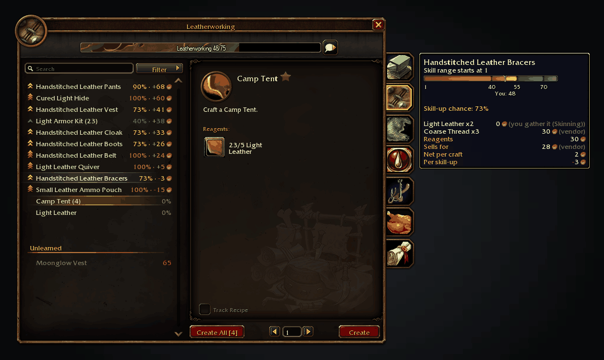
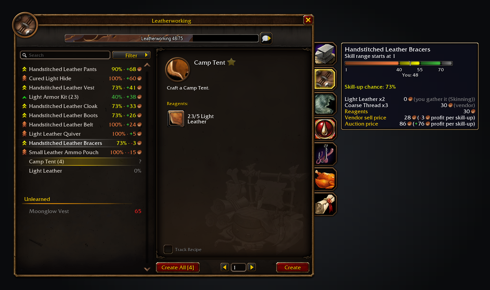
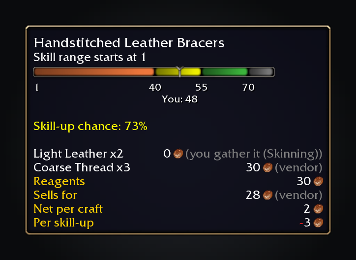
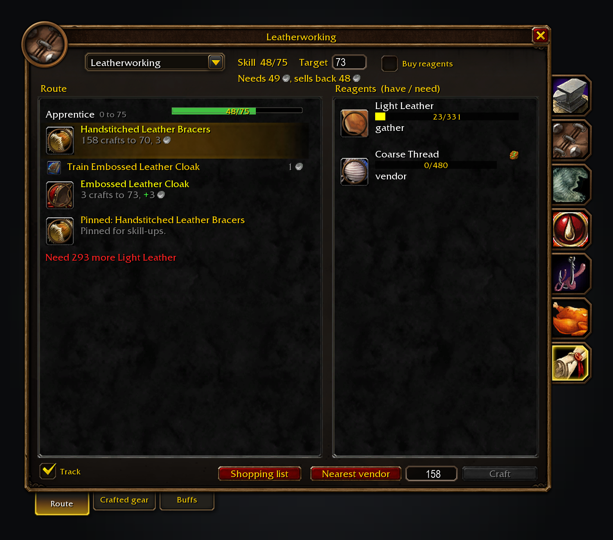
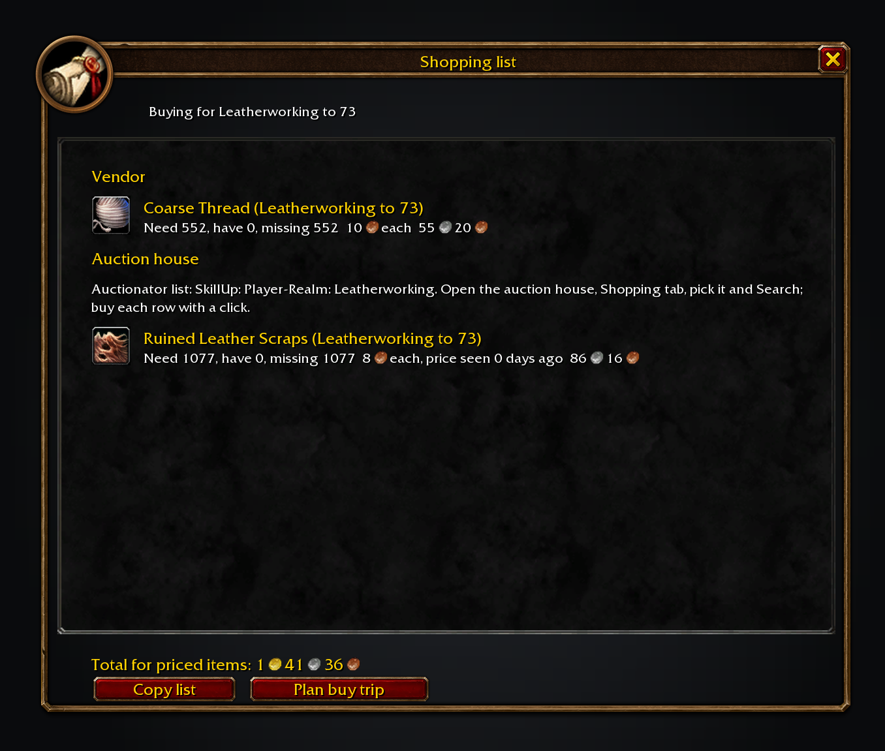
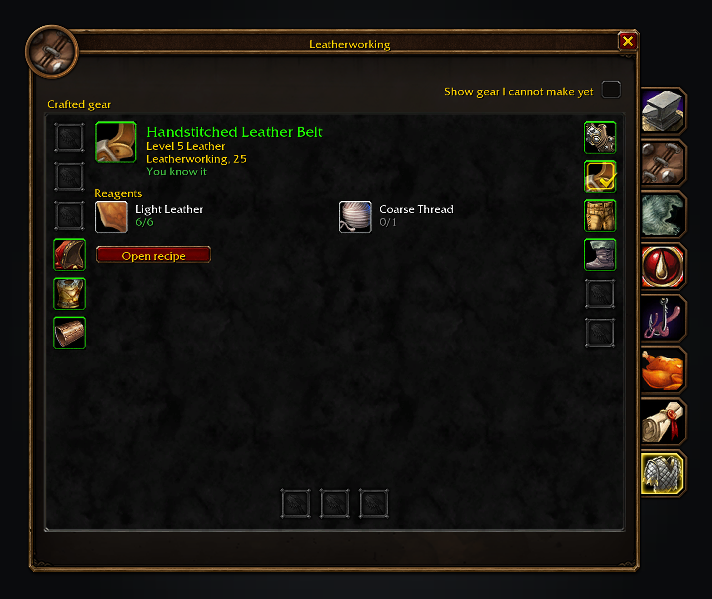
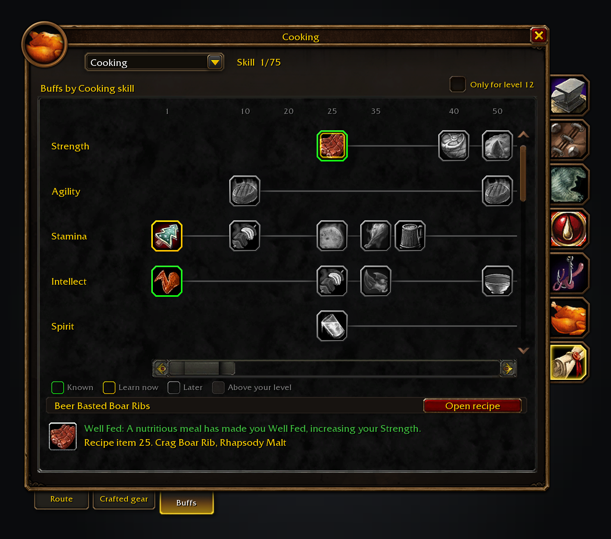
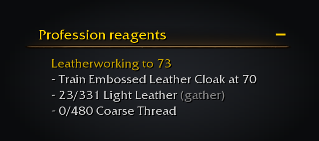
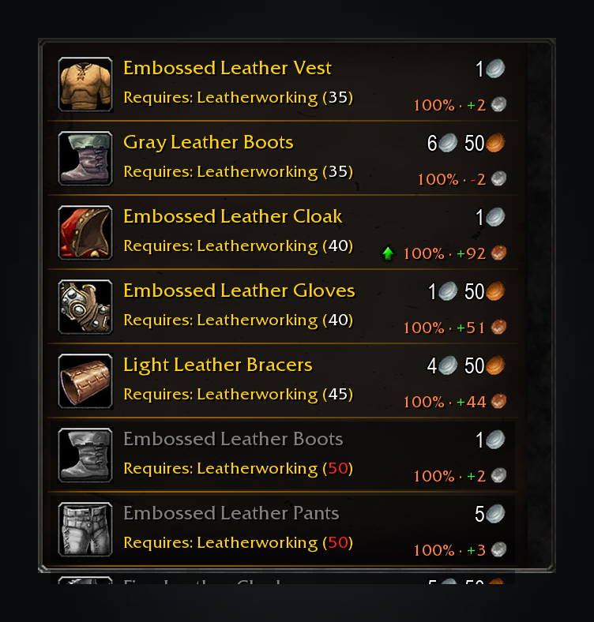
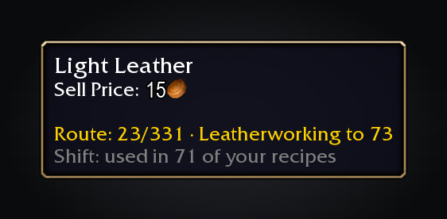

<h1 align="center">SkillUp Forever</h1>

Classic profession-levelling numbers inside WoW: Forever's Professions window. 

   

SkillUp Forever shows skill-up chances, recipe costs and colour thresholds in the Professions window. Its side panel has levelling routes, shopping lists, crafted gear and the buffs each profession makes.

From 48 to 60 the rows re-sort by cost per skill-up, and Handstitched Leather Bracers turns green at 55.

Each row shows its chance and cost; the tooltip beside the window prices each reagent. This character skins, so Light Leather is free.

The recipe tooltip draws the thresholds on the game's own bar with your skill marked, then each reagent's price and the cost per skill-up.

## Features

- **Recipe rows and tooltips** show skill-up chance, cost and colour thresholds.
- **Recipe rows** show skill-up chances, costs and how many your bags can make, while keeping the game's own list width.
- **Unlearned recipes** can sit under the learned ones in the same list. A setting, off by default, greys them and marks each with its trainer or recipe item and the skill it asks, and hovering one shows its reagents, cost and skill-up colours like a learned recipe's. They cannot be selected or crafted.
- **Sorting** orders recipes by difficulty range start, chance, cheapest skill-ups or newest learned first. *Default* restores the game's categories and filters.
- **Buffs only** filters the list to the elixirs, flasks, Well Fed food, protection potions, stones, oils, armour kits and scopes you can use at your level, highest required level first, with unlearned ones following when *List unlearned recipes* is on.
- **Levelling routes** list crafts, trainer visits, skill books and rank quests to your target skill, including fees, tools and stations. Steps allow for unlucky skill-ups. Cheaper crafted reagents become their own steps; a route that stops short names recipes that could extend it. Right-click a recipe to pin it for skill-ups or choose *Not this recipe* to plan without it. [Route details](docs/route.md#levelling-route).
- **Shopping lists** count reagents against your bags and bank. *Buy reagents* is on for a new character, so materials your professions gather are bought unless you choose to gather them. Track the list beside quests, buy vendor stock and keep an Auctionator list up to date. At the auction house, search a recipe's reagents for as many crafts as you choose. [Shopping details](docs/route.md#shopping-list).
- **Trainer annotations** show chance and cost, with a green arrow on the recipe that best extends or cheapens your route.
- **Reagent tooltips** show what tracked routes need. Hold Shift for every recipe that uses the item and still skills up.
- **Gathering nodes** show the Herbalism or Mining skill they need, coloured at yours, on English clients.
- **Crafted gear** shows the newest item you could craft for each slot, with its recipe, reagents and learning location. Enable its tab in settings. [Gear details](docs/gear.md).
- **Buffs** show what each profession can make for your level, on a skill timeline: known buffs, the ones you can learn now, and the ones still ahead. Pick the profession from the page's own dropdown, including crafters you do not have. [Buffs details](docs/buffs.md).

The route tab from 48 to 73: belts to 56, then train the pants, cure the hides they need and craft the rest of the way, with where each reagent comes from.

The shopping list groups what is missing by source, shows bag and alt holdings alongside current prices, and can start a vendor trip.

The gear tab, turned on in settings: each slot shows the newest thing this character could craft for it.

The buffs tab: each effect's items in the column of the skill it is learned at, scrolled to the rank divider, with the selected buff's words, source and reagents.

Tracked, the same route sits beside your quests: the next trainer visit and what's still missing.

At the trainer, every recipe shows its chance and cost; a green arrow marks the one that best extends or cheapens your route.

Hover a reagent to see how much your tracked routes need.

SkillUp keeps a local count of distinct recipes observed as learned. Repeated scans and relearning the same recipe do not increase the total. Recipes in linked or guild profession views do not count.

## Install

Install it from [CurseForge](https://www.curseforge.com/wow/addons/skillup-forever) or [Wago Addons](https://addons.wago.io/addons/skillup-forever), or download the zip from [Releases](https://github.com/cjber/skillup-forever/releases). To install the zip by hand, extract it into the WoW: Forever client's `Interface/AddOns/` folder (`_forever_` on the live client, `_classic_beta_` on the beta).

## Usage

Open a profession and the numbers are already there.

| Command | What it does |
|---|---|
| `/skillup` | Open the settings (also in Settings → AddOns, or from the addon compartment on the minimap) |
| `/skillup skipped` | List the recipes you said *Not this recipe* to on this character, with their IDs |
| `/skillup unskip <ID>`, `/skillup unskip all` | Show a skipped recipe, or every one, in the route again |
| `/skillup audit` | With a profession open, compare the bundled thresholds with the colours the game shows and print any mismatch |
| `/skillup report` | Show a report to copy into a bug report: versions, professions, routes, the audit and recent errors |
| `/skillup issue` | Open a ready-made GitHub issue link to report a bug or request a feature |
| `/skillup shopping`, `/skillup shop` | Open the shopping list for tracked professions, copy it, or plan a buy trip with Shortest Path Forever |
| `/skillup trainers` | List the trainer skill requirements SkillUp guessed, and which ones a trainer has confirmed or shown differently |

Settings cover rows and tooltips, the recipe list's width, what crafts count for, sort order, the route, crafted gear and buffs tabs, trainer annotations, reagent and gathering tooltips and Forever addon hints. Turn off **Show tracked professions** to hide the tracker, or **Attach to quest tracker** to drag the Forever column. **Tracker scale** sizes the shared tracker from 50% to 200%, where 100% matches the game's own tracker.

## Prices

Each reagent uses the cheapest known vendor or Auctionator price. Common vendor supplies have bundled prices; visiting a vendor records its prices and reputation discounts. Materials your professions gather are bought with *Buy reagents* on, which is the default; choose gathering to make them free, or turn on *Value gathered materials at what they'd sell for* to cost them at what they would sell for. *Price self-supplied reagents at auction values* prices whatever you gather, loot or already own at its market value, and leaves it unpriced rather than free when there is none.

Auction prices are Auctionator's latest recorded price for reagents and crafted items. With [TradeSkillMaster](https://www.curseforge.com/wow/addons/tradeskill-master) instead, or for an item Auctionator has no price for, they are its AuctionDB values, kept current by the TSM desktop app. SkillUp never scans the auction house itself: scan with Auctionator to update prices. Missing prices stay unknown and leave affected recipes out of the route.

A craft's vendor sell value comes off its cost, or its auction value after the 5% cut if you choose. Profit shows a green `+` and cost a red `-`. Cost per skill-up is net craft cost divided by skill-up chance; *Money on recipe rows* shows net per craft instead, on recipes that no longer give skill too.

## How the numbers work

Each recipe has four thresholds: orange (start of its skill range), yellow, green and grey. Chance follows the Classic formula:

| Colour | Chance |
|---|---|
| Orange | 100% |
| Yellow, green | `(grey − skill) / (grey − yellow)` |
| Grey, or at your skill cap | 0% |

The colour always comes from the game, so the addon never disagrees. Thresholds and recipe data come from the Forever client's `SkillLineAbility` (via [wago.tools](https://wago.tools)). The grey threshold is the game's own live value where it reports one. Missing or contradictory ranges show `?`. Training requirements are separate from these difficulty bands.

**Found a wrong number?** Open that profession, run `/skillup report` and paste its text into a [Wrong number issue](https://github.com/cjber/skillup-forever/issues/new?template=wrong_number.yml).

## Works alongside

All optional: Auctionator supplies auction prices and takes the shopping list, TomTom draws waypoint arrows, and Syndicator shows your other characters' reagents. [Questie](https://www.curseforge.com/wow/addons/questie) names the vendors, quests and trainers the route points to, and [AtlasLoot Classic Forever](https://www.curseforge.com/wow/addons/atlasloot-forever) tells it which scroll teaches which recipe; without them the route still plans your crafts, and says in one line what to install for the rest.

<!-- forever-family:start -->

## The Forever addons

Each one works on its own, and they work together when you install more than one.

| Addon | What it does | Issues |
|---|---|---|
| [Shortest Path Forever](https://www.curseforge.com/wow/addons/shortest-path-forever) | Plans journeys on foot, by air, by sea and through portals, with directions in the tracker. | [Issues](https://github.com/cjber/shortest-path-forever/issues) |
| [Adventure Guide Forever](https://www.curseforge.com/wow/addons/adventure-guide-forever) | Suggests quests for your level and routes you from one to the next. | [Issues](https://github.com/cjber/adventure-guide-forever/issues) |
| [SkillUp Forever](https://www.curseforge.com/wow/addons/skillup-forever) | Shows skill-up chances, recipe costs and levelling routes in the Professions window. | [Issues](https://github.com/cjber/skillup-forever/issues) |
| [Legacy Forever](https://www.curseforge.com/wow/addons/legacy-forever) | Shows your unfinished Legacy challenges on the world map and tracks the ones you choose. | [Issues](https://github.com/cjber/legacy-forever/issues) |
| [Tweaks Forever](https://www.curseforge.com/wow/addons/tweaks-forever) | Adds quest automation, rare alerts and merchant options to the game's settings. | [Issues](https://github.com/cjber/tweaks-forever/issues) |
| [Field Guide Forever](https://www.curseforge.com/wow/addons/field-guide-forever) | Keeps a cosmetic journal of the creatures you kill, zone by zone. | [Issues](https://github.com/cjber/field-guide-forever/issues) |
| [Commissions Forever](https://www.curseforge.com/wow/addons/commissions-forever) | Lists your commission turn-ins, the materials in your bags and the next NPC to visit. | [Issues](https://github.com/cjber/commissions-forever/issues) |
| [Macro Assist Forever](https://www.curseforge.com/wow/addons/macro-assist-forever) | Adds a macro window with every macro in one list, a mono editor with live checks, and history. | [Issues](https://github.com/cjber/macro-assist-forever/issues) |

Bug reports, feature requests and pull requests are welcome on each addon's GitHub. Everyone whose report or idea ships is thanked by name on the Thanks page in game, in the store page and in the changelog, unless they ask not to be.

For help, ideas and each day's release notes, join [cjber's Workshop on Discord](https://discord.gg/FpHugGxRJY).

<!-- forever-family:end -->

With [Shortest Path Forever](https://www.curseforge.com/wow/addons/shortest-path-forever), clicking a trainer or vendor in the route plans the trip there, and SkillUp picks the nearest one by travel time. [Adventure Guide Forever](https://www.curseforge.com/wow/addons/adventure-guide-forever) shows each profession's next steps in its Professions tab. A tracked route shares one tracker column with the Shortest Path, Adventure Guide and Legacy Forever sections, above your quests.

## Development

Link the checkout into the game (`ln -s "$PWD" ".../Interface/AddOns/SkillUpForever"`) and run the gate under [Commands in AGENTS.md](AGENTS.md#commands) ([tools/README.md](tools/README.md) covers the data generators). CI runs the same gate plus actionlint, zizmor, gitleaks and the project rules; a daily job opens a pull request on a newer Forever build.

Run `luajit tests/bench.lua` to measure loading, route rebuilds, event bursts and cached lookups in the headless client. These are CPU timings, not in-game latency measurements.

**Releasing:** follow the [release skill](.agents/skills/release/SKILL.md) for data, copy and screenshot checks, main-branch CI, signed tags and store verification. The BigWigs packager publishes the version's changelog entry to GitHub, CurseForge and Wago.

**Translating:** translated into German, French, Spanish, Brazilian Portuguese, Russian, Korean and Chinese (machine translated; corrections welcome through the [translation form](https://github.com/cjber/skillup-forever/issues/new?template=translation.yml)).

**Contributing:** read [CONTRIBUTING.md](https://github.com/cjber/.github/blob/main/CONTRIBUTING.md) and [AGENTS.md](AGENTS.md) first. Report security problems privately, as [SECURITY.md](https://github.com/cjber/.github/blob/main/SECURITY.md) describes.

## Support

The addon is free and stays GPL-3.0. If it saves you time, you can [sponsor me on GitHub](https://github.com/sponsors/cjber), which takes no fees, or [buy me a coffee on Ko-fi](https://ko-fi.com/cjber); nothing is locked behind it and there is no paid version.

## Credits

Thresholds come from the game via [wago.tools](https://wago.tools), trainer fees, drop chances and gathered reagents from [CMaNGOS classic-db](https://github.com/cmangos/classic-db) (GPL-3.0), and vendor reagents from [LibPeriodicTable-3.1](https://github.com/doadin/libperiodictable-3-1) (LGPL-2.1). Some features were inspired by [Polestar](https://github.com/fitzforge/polestar) by Fitz, such as the skill colour on gathering nodes; no code was copied. Fitz is welcome to use our code.

<!-- forever-credits:start -->

Thanks to kopuliak, Mouchoir, bromidious, Chuujitsuna, trias6657, iPulse, cotijelucie, st3nlee, prokn4h, CtrlDKhayos, Diamondclaw, mimmordino, soviman1, FreakinNerd, nookie909, Rambomst, ItachiGrave, .phear, Brainc3ll, berserkerlxl, SilentGentlemanSG, BallaRa, kurila11478, Bolthorr, TechnoHunter, Viper2042, Syrberus, zazomazzo, Setuaro, 0xTrk, 3kinex, icouldonlygetthisname, jakeyjake07, Rekalicious, leenagil-coder, Weythx, lokitako, Rawveggie, sundered1985, hardliquor, CodexFD, rockhumper84, Kozoaku, Kirdan, rick1tz, time2w8, ThePNAG, derzwiebelritter, Ekallo, CorvidofShadows13, Sogu, achubbert, jackthereaper_, qwertzyxc and everyone who reported a bug or asked for a feature.

<!-- forever-credits:end -->

## Licence

GPL-3.0-or-later. Vendors, quests, NPC places and scroll recipes are read in game from your own Questie and AtlasLoot, and none of their data is bundled. Every input and its licence: [THIRD_PARTY.md](THIRD_PARTY.md).

Made by Cillian Berragan · [cillian.dev](https://cillian.dev) · [GitHub](https://github.com/cjber) · [Twitter](https://twitter.com/cjberragan)

Built with AI assistance.
