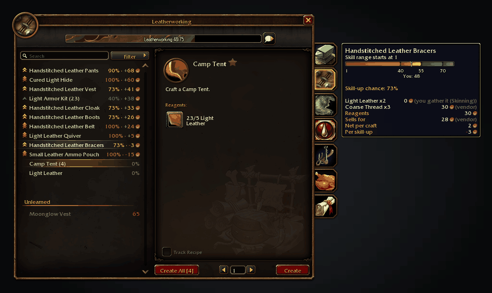
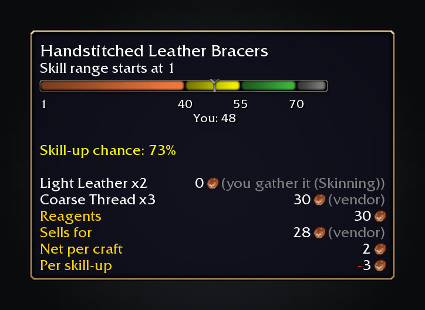
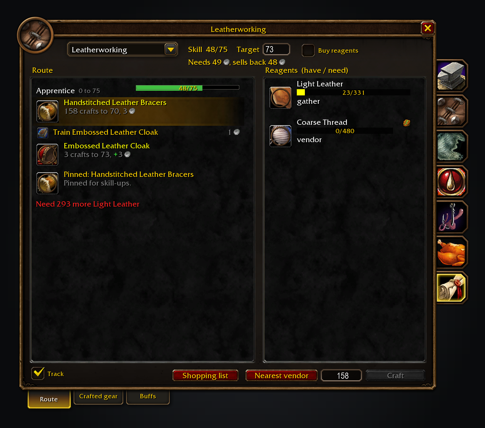
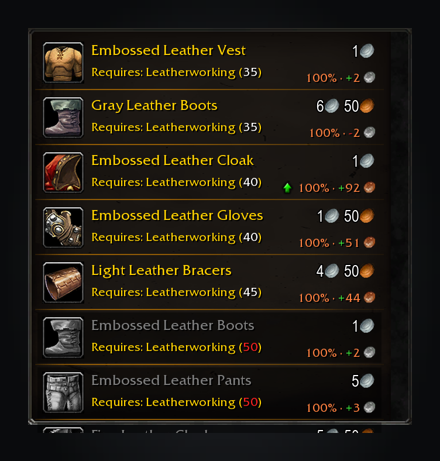
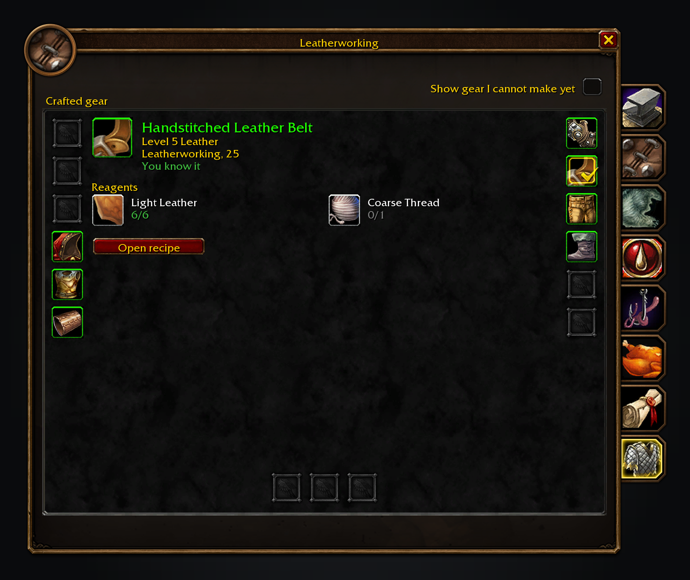
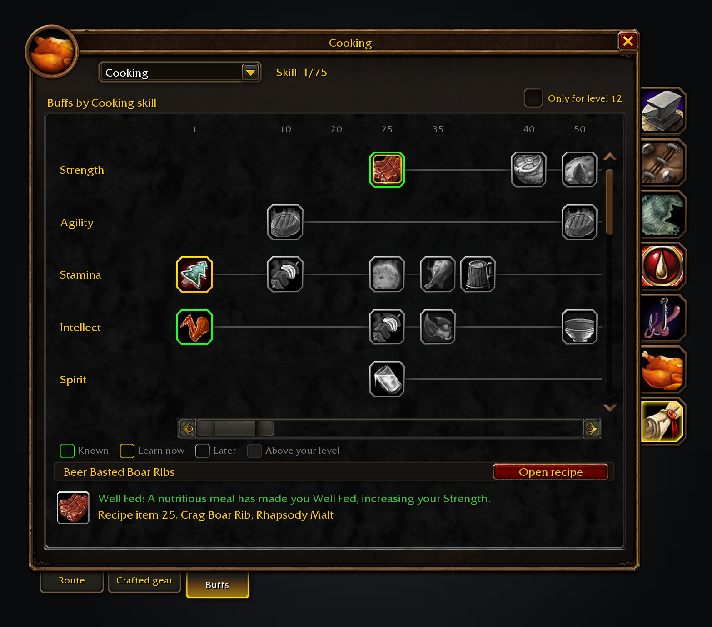

SkillUp Forever shows skill-up chances, recipe costs and colour thresholds in the Professions window. Its side panel has levelling routes, shopping lists, crafted gear and the buffs each profession makes.

Free, with nothing locked behind it. If it saves you time, you can [sponsor me on GitHub](https://github.com/sponsors/cjber), which takes no fees, or [buy me a coffee on Ko-fi](https://ko-fi.com/cjber). For help and each day's release notes, [join me on Discord](https://discord.gg/FpHugGxRJY).

  

From 48 to 60 the rows re-sort by cost per skill-up, and the bracers turn green at 55.

Colour thresholds and reagent prices for the recipe you hover.

The route tab from 48 to 73: what to train, what to craft and where reagents come from.

At the trainer, a green arrow marks the recipe that best extends or cheapens your route.

The gear tab, turned on in settings: each slot shows the newest thing this character could craft for it.

The buffs tab: what each profession can make for your level, in columns on a skill timeline.

These images are generated previews of the SkillUp UI.

## Features

- **Recipe rows and tooltips.** Each recipe shows its skill-up chance, cost and colour thresholds, in the row and in its tooltip. Missing data shows `?`.
- **A sortable recipe list.** See how many your bags can make after each name. Sort by difficulty range start, chance, cheapest skill-ups or newest learned first.
- **Unlearned recipes.** A setting, off by default, lists them greyed under the learned ones, each marked with its trainer or recipe item and the skill it asks. Hovering one shows its reagents, cost and skill-up colours; it cannot be crafted.
- **Levelling routes.** Crafts, trainer visits, skill books and rank quests to your target skill, including fees, tools and stations, with steps that allow for unlucky skill-ups. Cheaper crafted reagents become their own steps, routes that stop short name recipes that could extend them, and right-clicking a recipe and choosing *Not this recipe* plans without it.
- **Shopping lists.** Reagents are counted against bags and bank. Buying is the default, so materials your professions gather are bought unless you choose to gather them; track the list beside quests, buy vendor stock and keep an Auctionator list up to date. The Shopping list says how that list works, and at the auction house you can search a recipe's reagents for as many crafts as you choose.
- **Trainers, reagents and gathering.** Trainers mark the best recipe to train next, and reagent tooltips show what tracked routes need. On English clients, gathering nodes show the Herbalism or Mining skill they need, coloured at yours.
- **Crafted gear and buffs.** The gear tab, enabled in settings, shows the newest craft for each slot with its recipe, reagents and learning location. The buffs tab shows what each profession can make for your level on a skill timeline: known buffs, the ones you can learn now and the ones still ahead, for any profession picked from its dropdown, including crafters you do not have.

## Prices

Each reagent uses the cheapest known vendor or Auctionator price; visiting a vendor records its prices and reputation discounts. Materials your professions gather are bought with *Buy reagents* on, which is the default; choose gathering to make them free, or turn on *Value gathered materials at what they'd sell for* to cost them at what they would sell for. *Price self-supplied reagents at auction values* prices whatever you gather, loot or already own at its market value, and leaves it unpriced rather than free when there is none.

SkillUp never scans the auction house itself: scan with Auctionator to update prices. A gatherable reagent nobody has priced stays on the route under *Auction house* as a price unknown; other missing prices stay unknown and leave affected recipes out of the route.

A craft's vendor sell value comes off its cost, or its auction value after the 5% cut if you choose. Profit shows a green `+`.

## Usage

Open a profession and the numbers are already there.

- `/skillup` opens the settings (also in Settings > AddOns and the minimap's addon compartment).
- `/skillup skipped` lists the recipes you said *Not this recipe* to, and `/skillup unskip <ID>` (or `all`) brings them back.
- `/skillup share on|off` controls sharing with your guild and group. Sharing is on by default, and the window's Share my progress switch and the settings checkbox turn it off.
- `/skillup audit`, with a profession open, prints where the bundled thresholds differ from the colours the game shows.
- `/skillup issue` opens a ready-made GitHub issue link to report a bug or request a feature.
- `/skillup trainers` lists the trainer skill requirements SkillUp guessed and which ones a trainer has confirmed.

Settings cover rows and tooltips, the recipe list's width, prices, the route, gear and buffs tabs, trainer annotations, sorting, reagent tooltips and Forever addon hints.

For a bug report, paste `/skillup report`. It shows a report to copy.

Translated into German, French, Spanish, Brazilian Portuguese, Russian, Korean and Chinese (machine translated; corrections welcome through the [translation form](https://github.com/cjber/skillup-forever/issues/new?template=translation.yml)).

<!-- forever-family:start -->

## The Forever addons

Each one works on its own, and they work together when you install more than one.

| Addon | What it does | Issues |
|---|---|---|
| [Shortest Path Forever](https://www.curseforge.com/wow/addons/shortest-path-forever) | Plans journeys on foot, by air, by sea and through portals, with directions in the tracker. | [Issues](https://github.com/cjber/shortest-path-forever/issues) |
| [Adventure Guide Forever](https://www.curseforge.com/wow/addons/adventure-guide-forever) | Suggests quests for your level and routes you from one to the next. | [Issues](https://github.com/cjber/adventure-guide-forever/issues) |
| [SkillUp Forever](https://www.curseforge.com/wow/addons/skillup-forever) | Shows skill-up chances, recipe costs and levelling routes in the Professions window. | [Issues](https://github.com/cjber/skillup-forever/issues) |
| [Legacy Forever](https://www.curseforge.com/wow/addons/legacy-forever) | Shows your unfinished Legacy challenges on the world map and tracks the ones you choose. | [Issues](https://github.com/cjber/legacy-forever/issues) |
| [Tweaks Forever](https://www.curseforge.com/wow/addons/tweaks-forever) | Adds quest automation, rare alerts and merchant options to the game's settings. | [Issues](https://github.com/cjber/tweaks-forever/issues) |
| [Field Guide Forever](https://www.curseforge.com/wow/addons/field-guide-forever) | Keeps a cosmetic journal of the creatures you kill, zone by zone. | [Issues](https://github.com/cjber/field-guide-forever/issues) |
| [Commissions Forever](https://www.curseforge.com/wow/addons/commissions-forever) | Lists your commission turn-ins, the materials in your bags and the next NPC to visit. | [Issues](https://github.com/cjber/commissions-forever/issues) |
| [Macro Assist Forever](https://www.curseforge.com/wow/addons/macro-assist-forever) | Adds a macro window with every macro in one list, a mono editor with live checks, and history. | [Issues](https://github.com/cjber/macro-assist-forever/issues) |

Bug reports, feature requests and pull requests are welcome on each addon's GitHub. Everyone whose report or idea ships is thanked by name on the Thanks page in game, in the store page and in the changelog, unless they ask not to be.

For help, ideas and each day's release notes, join [cjber's Workshop on Discord](https://discord.gg/FpHugGxRJY).

<!-- forever-family:end -->

With [Shortest Path Forever](https://www.curseforge.com/wow/addons/shortest-path-forever), clicking a trainer or vendor in the route plans the trip there, and SkillUp picks the nearest one by travel time. [Adventure Guide Forever](https://www.curseforge.com/wow/addons/adventure-guide-forever) shows each profession's next steps in its Professions tab. A tracked route shares one tracker column with the Shortest Path, Adventure Guide and Legacy Forever sections, above your quests.

<!-- forever-credits:start -->

Thanks to kopuliak, Mouchoir, bromidious, Chuujitsuna, trias6657, iPulse, cotijelucie, st3nlee, prokn4h, CtrlDKhayos, Diamondclaw, mimmordino, soviman1, FreakinNerd, nookie909, Rambomst, ItachiGrave, .phear, Brainc3ll, berserkerlxl, SilentGentlemanSG, BallaRa, kurila11478, Bolthorr, TechnoHunter, Viper2042, Syrberus, zazomazzo, Setuaro, 0xTrk, 3kinex, icouldonlygetthisname, jakeyjake07, Rekalicious, leenagil-coder, Weythx, lokitako, Rawveggie, sundered1985, hardliquor, CodexFD, rockhumper84, Kozoaku, Kirdan, rick1tz, time2w8, ThePNAG, derzwiebelritter, Ekallo, CorvidofShadows13, Sogu, achubbert, jackthereaper_, qwertzyxc and everyone who reported a bug or asked for a feature.

<!-- forever-credits:end -->

Source code and issues: [github.com/cjber/skillup-forever](https://github.com/cjber/skillup-forever). Licence: GPL-3.0-or-later.

Built with AI assistance.
